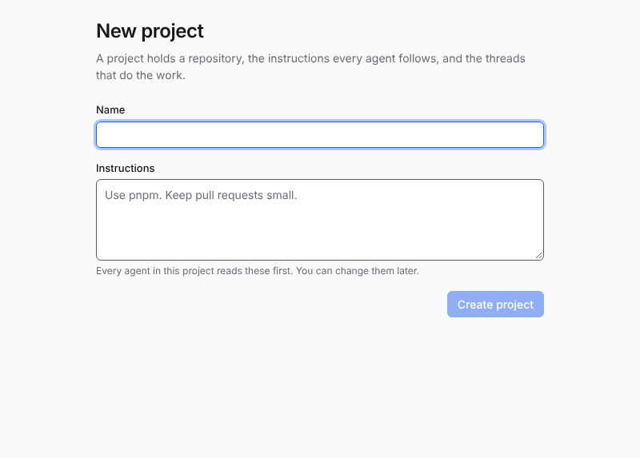
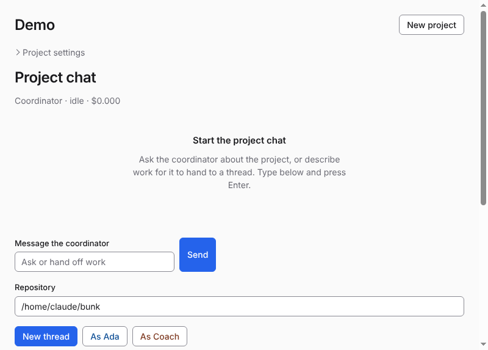
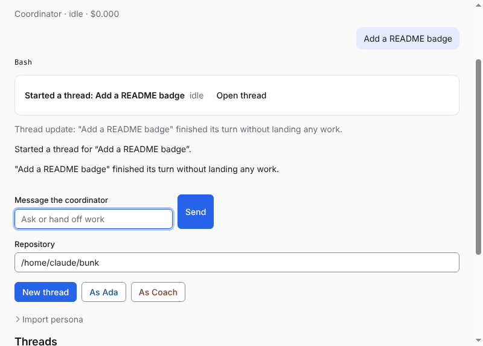
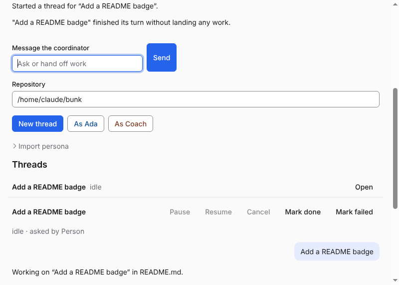
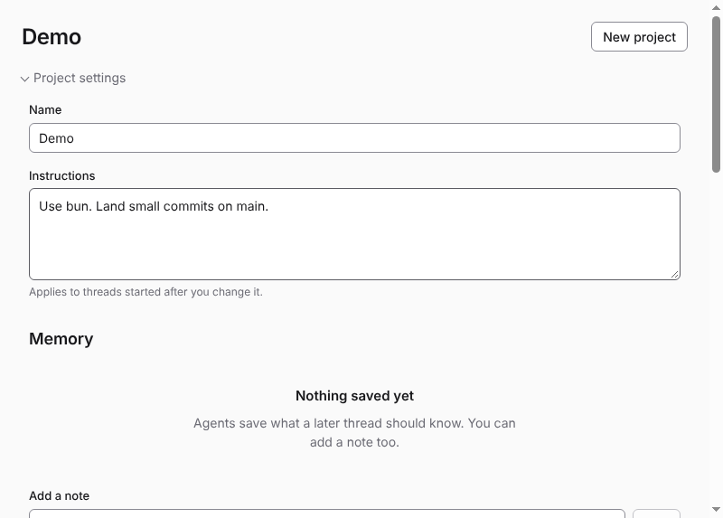

# UI tour

Headless screenshots of pre-k's one window, captured with no model or key (the scripted harnesses):

```sh
PREK_HARNESS=scripted bunx point smoke --no-secrets --screenshot .point/smoke/tour --steps smoke/ui-tour.json --timeout 60000
```

Each shot is the visible 800x600 part of the window after a step. Everything is one scrolling page today.

1. [New project](1-new-project.png): the first screen, a name and the instructions every agent reads.
2. [Project chat](2-project-chat.png): the project, with the coordinator chat at the top.
3. [The coordinator starts a thread](3-coordinator-starts-thread.png): "Add a README badge" becomes a thread card.
4. [Threads and a thread view](4-threads-and-thread-view.png): the thread list with the opened thread, its controls and transcript.
5. [Project settings](5-project-settings.png): name, instructions and project memory.






